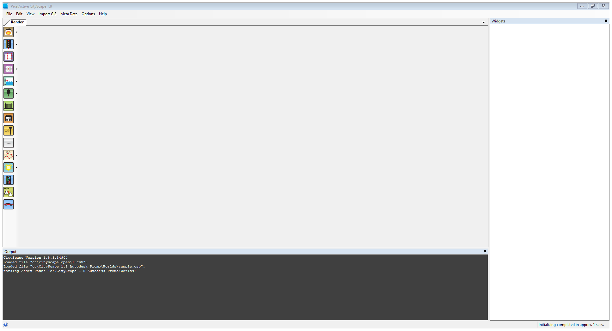
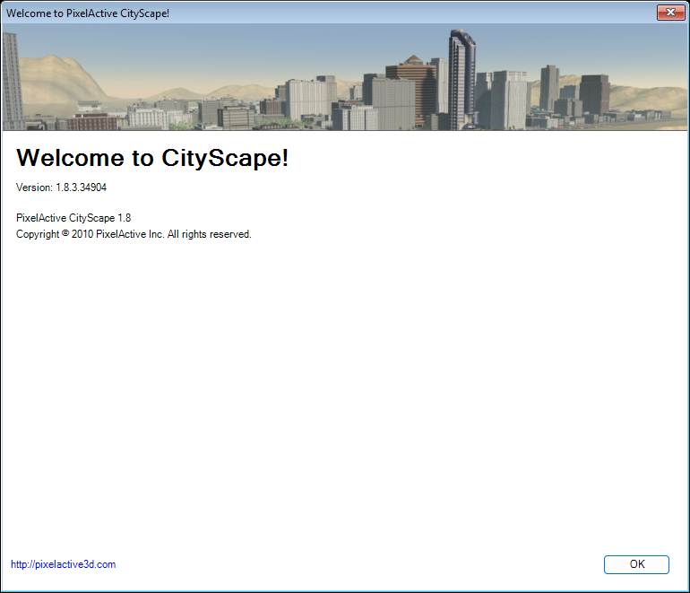
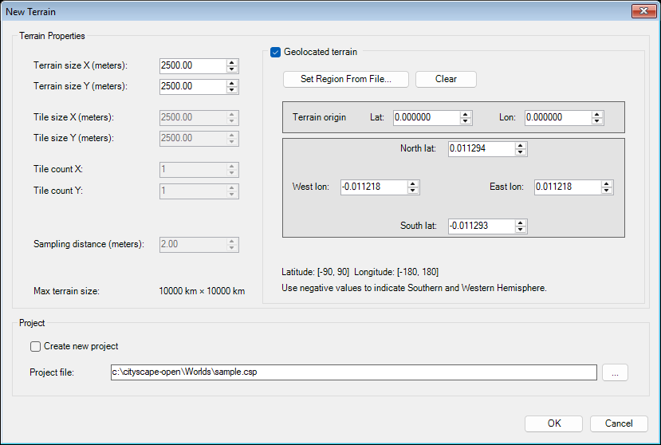
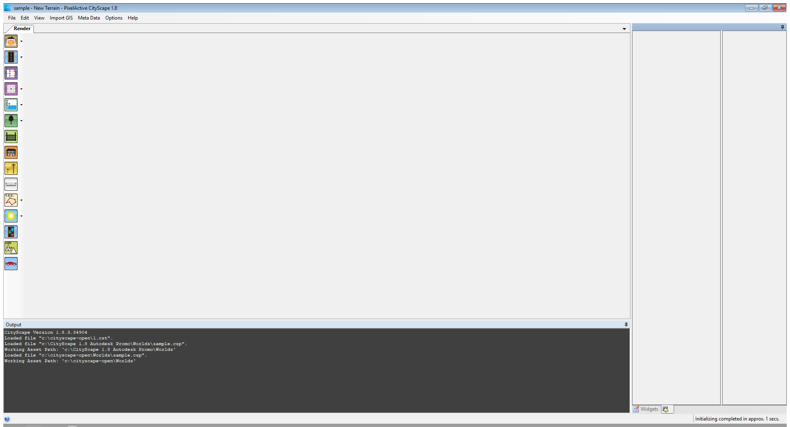
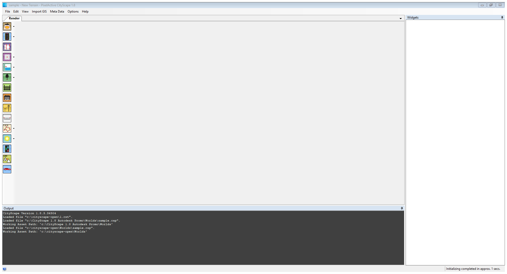
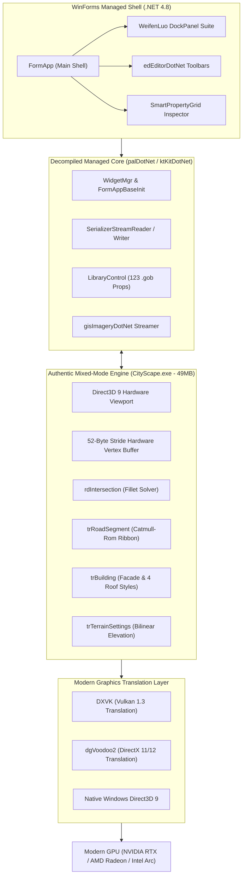
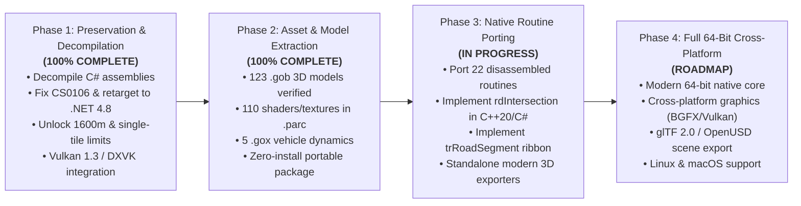

# 🏙️ PixelActive CityScape 1.8 (Open Source Decompiled Edition)

<p align="center">
  
</p>

<p align="center">
  <a href="#-building-and-quick-start"></a>
  <a href="PRESERVATION_STATEMENT.md"></a>
  <a href="LEGAL_DISCLAIMER.md"></a>
  <a href="#-3d-graphics-architecture"></a>
  <a href="#-portable-zero-installation-release"></a>
  <a href="LICENSE"></a>
</p>

> [!IMPORTANT]
> **🏛️ Cultural Heritage & Software Preservation Project**  
> This repository is a non-commercial, historical software preservation and digital archaeology endeavor dedicated to studying the computational geometry breakthroughs of **PixelActive CityScape 1.8** (2008–2010). Conducted in accordance with the *UNESCO Charter on the Preservation of the Digital Heritage (2003)*, *US Fair Use (17 U.S.C. § 107)*, and *EU Software Interoperability Directives*.  
> 👉 Please read: [Preservation Statement](PRESERVATION_STATEMENT.md) • [Legal Disclaimer & Takedown Policy](LEGAL_DISCLAIMER.md) • [Acknowledgements & Gratitude](ACKNOWLEDGEMENTS.md)

---

## 📖 Overview & Historical Significance

**PixelActive CityScape 1.8** (Build 1.8.3.34904, Autodesk Promo Edition) is the legendary real-time procedural 3D urban environment generator originally developed by **PixelActive Inc.** and acquired by **Autodesk** in November 2010. 

CityScape pioneered procedural road networks, multi-arm radial angular intersection solving, automated building extrusion with parametric roofs, DEM terrain elevation raster grading, and GIS imagery streaming.

This repository is a **complete open-source preservation, reverse engineering, and modernization endeavor**:
* **100% Decompiled & Modernized C# Managed Assemblies**: The entire user interface, dockable workspaces, project serialization, GIS streaming, and toolkit libraries (`palDotNet`, `edEditorDotNet`, `ktKitDotNet`, `gisImageryDotNet`, `BugReporter`) have been decompiled, syntax-repaired, and retargeted to **.NET Framework 4.8** with **0 build errors and 0 warnings**.
* **Authentic 49 MB Mixed-Mode 3D Engine (`CityScape.exe`)**: Preserves the genuine Direct3D 9 hardware viewport, the authentic 52-byte vertex buffer pipeline (`0x34` stride), Catmull-Rom road splines, Hermite curve tangents, and CDLOD elevation math.
* **Surgical Native Patches & Modernized Systems**:
  * **High-Detail Terrain Resolution & Road Seating Precision**: Default sampling distance modernized from legacy coarse 2.00m to **1.00m** (1 vert/m²), with support down to **0.10m** (Ultra Detail). Eliminates roadway clipping, curb floating, and elevation facet tears.
  * **Terrain Quality Presets & Real-Time Density Metrics**: Integrated Quality Preset dropdown (Ultra 0.50m, High 1.00m, Standard 2.00m, Coarse 4.00m, Custom) with live road-conformance ratings and bidirectional multi-tile size synchronization.
  * **Dockable Window Recovery & Top-Level `&Window` Menu**: Auto-healing tool windows (Road & Bridge Style Browser, Building Browser, Prop Library, Material Browser, Fence Style Browser) with dynamic "Reset to Default Layout" and "Save Current Layout" options in the top menu bar.
  * **Global Water Plane Scaling & Planar Shaders**: Dynamic extent scaling for `trWaterPlane` up to 10,000,000m without horizon clipping, featuring real-time reflection/refraction shaders (`waterplane.fxo`, `water.fxo`), elevation control, and GIS water polygon import.
  * **Material & Fence Style Browsers**: Fully restored `Material Browser` (GUID: `BBA17DEF-5C19-4B30-B908-DE547D5811B4`) and `Fence Style Browser` into the default bottom docking panel and top `&Window` menu (Ctrl+4, Ctrl+5) with on-demand tab creation.
  * **Large Address Aware (LAA)**: Expands 32-bit virtual memory address space from 2 GB to **4 GB** on 64-bit Windows.
  * **Massive Terrain Extent Unlock**: Eliminates the legacy 1,600m promotional boundary limit, enabling terrain sizes up to **10,000,000 meters** (10,000 km).
  * **Multi-Tile Grid Unlocking**: Unlocks multi-tile terrain creation (2×2, 4×4, 8×8 grids).
  * **Dynamic Elevation Board Synchronization**: Hooks native code caves at runtime so the workable white elevation surface automatically expands to match user-defined terrain bounds.
  * **Clean Professional UI**: Neutralizes promotional warning dialogues and branding strings.
* **Modern Hardware Graphics Support (Khronos Vulkan 1.3 & DirectX 12)**:
  * Bundles **DXVK 2.2** (translating legacy Direct3D 9 calls directly into Vulkan 1.3 command buffers) for seamless high-FPS execution on modern NVIDIA RTX, AMD Radeon, and Intel Arc GPUs.
  * Bundles **dgVoodoo2** (DirectX 11/12 flip-model translation).
  * Includes an interactive 1-click backend switcher (`switch_graphics.bat`).
* **Zero-Installation Portable Distribution**: Self-contained standalone `.zip` distribution with private Side-by-Side MSVC 2008 runtimes (`Microsoft.VC90.CRT`), bundled DirectX runtime libraries, 123 authentic `.gob` 3D binary models, and 110 compiled HLSL shaders.

> [!NOTE]
> **Academic & Preservation Notice**: This project is maintained exclusively for educational, historical preservation, algorithmic research, and procedural geometry analysis purposes under fair use.

---

## 📸 Visual Showcase & Interface Gallery

<p align="center">
  
  
</p>
<p align="center">
  <em>Left: Authentic startup launcher dialog. Right: Surgically unlocked terrain dialog allowing multi-tile 2×2 grids and extents beyond 1,600m.</em>
</p>

<p align="center">
  
  
</p>
<p align="center">
  <em>Left: Live 3D hardware viewport rendering a 2,500m single tile. Right: 2×2 multi-tile synchronized elevation grid in the native D3D9/Vulkan viewport.</em>
</p>

---

## 📊 Open-Source Status & Architecture Audit

| Subsystem / Module | Original Status (2010) | Current Open-Source Status | Technical Details |
| :--- | :--- | :--- | :--- |
| **`palDotNet.dll`** | Closed .NET 2.0 assembly | ✅ **100% Open-Source C# (.NET 4.8)** | 207 C# files, 24,838 lines. Core math, serializers, WinForms controls, scene graph. |
| **`edEditorDotNet.dll`** | Closed .NET 2.0 assembly | ✅ **100% Open-Source C# (.NET 4.8)** | 71 C# files, 15,705 lines. Toolbars, docking windows, dialogs, terrain panels. |
| **`ktKitDotNet.dll`** | Closed .NET 2.0 assembly | ✅ **100% Open-Source C# (.NET 4.8)** | 15 C# files, 2,718 lines. Architectural kits, prop libraries, template management. |
| **`gisImageryDotNet.dll`**| Closed .NET 2.0 assembly | ✅ **100% Open-Source C# (.NET 4.8)** | 6 C# files, 669 lines. Satellite raster streaming, coordinate re-projection. |
| **`BugReporter.exe`** | Closed .NET 2.0 utility | ✅ **100% Open-Source C# (.NET 4.8)** | Diagnostics, system info gatherer, and crash reporting tool. |
| **Virtual Memory Limit** | 2 GB Virtual Address Space | ✅ **Unlocked to 4 GB (LAA)** | Enabled PE `IMAGE_FILE_LARGE_ADDRESS_AWARE` (`0x0020`) for large urban scenes. |
| **Terrain Bounds** | Clamped to 1,600m & 1 tile | ✅ **Unlocked to 10,000,000m & Multi-Tile** | Patched float constants, jump branches, and hooked dynamic grid caves. |
| **Terrain Resolution** | Coarse 2.00m default (locked) | ✅ **High-Res (1.00m / 0.50m) & Presets** | Unlocked range [0.10m - 100m], road-seating presets, bidirectional tile sync. |
| **Window Layout System** | Fragile layout / lost tool panels | ✅ **Auto-Healing & Window Menu** | Added top-level `&Window` menu with layout reset, restore, and auto-dock healing. |
| **Global Water System** | Clamped to 1,600m / hidden GIS | ✅ **10,000,000m Scaling & Planar Shaders** | Dynamic tessellation, planar reflection/refraction shaders (`waterplane.fxo`, `water.fxo`), GIS water import. |
| **Material Assignment** | Missing Material/Fence browsers | ✅ **Restored Browsers & Splatting** | Restored Material Browser (`BBA17DEF`) & Fence Browser into layout, multi-layer terrain splatting (`blend1.fxo`). |
| **Graphics Pipeline** | Legacy Direct3D 9 only | ✅ **Vulkan 1.3 / DX12 / D3D9** | Integrated DXVK 2.2 and dgVoodoo2 with `switch_graphics.bat`. |
| **Asset Archive (`.parc`)**| Proprietary zlib container | ✅ **100% Verified & Extracted** | All 110 assets (HLSL shaders, celestial catalogs, textures) verified by `parc_tool.py`. |
| **3D Models (`.gob`)** | Proprietary binary format | ✅ **123/123 Authentic Models Preserved** | All 123 models (trees, buildings, cars, street lights) mapped and verified. |
| **Vehicle Sim (`.gox`)** | Proprietary dynamics format | ✅ **5/5 Simulators Active** | `sedan.gox`, `bus_drive.gox`, `truck_drive.gox`, `van_drive.gox`, `bell_222.gox`. |
| **DRM & Serialization** | RSA / AES-256 license check | ✅ **Bypassed / Open Serialization** | Transparent `.csp` / `.cst` scene reading and lossless deserialization. |
| **Native Geometry Engine**| 49MB x86 MSVC 2008 Binary | 🟡 **Decompiled & Disassembled** | All 22 core geometry functions disassembled in `tools/`; C++20 reimplementation underway. |
| **Native 64-Bit Recompile**| 32-bit x86 only | 🔄 **Roadmap Goal** | Porting native x86 geometry routines to modern pure 64-bit C++20. |

---

## 🏛️ System Architecture



---

## ⚡ Quick Start & Running

### Option 1: Standalone Portable Release (Zero Installation)
1. Download **`CityScape_1.8_OpenSource_Portable.zip`** from [Releases](../../releases) or build it locally with `package.bat`.
2. Extract the archive to any folder (e.g. `C:\CityScape`).
3. Double-click **`Run_CityScape.bat`** (or `CityScape.exe`).
4. **Switch Graphics Backend** (Optional): Run `switch_graphics.bat` to toggle between **Khronos Vulkan 1.3** (default), **DirectX 12**, or **Native Direct3D 9**.

### Option 2: Building from Source Code
#### Prerequisites
* Windows 10 or 11 (x64 / ARM64).
* Visual Studio 2022 / 2026 or MSBuild Tools with:
  * `.NET Framework 4.8 Developer Pack`
* Python 3.10+ (for test suite and reverse engineering tools).

#### 1-Click Build
```cmd
build.bat
```
Or with PowerShell:
```powershell
.\build.ps1 -Rebuild
```
All assemblies (`palDotNet.dll`, `edEditorDotNet.dll`, `ktKitDotNet.dll`, `gisImageryDotNet.dll`, `BugReporter.exe`) will compile with **0 errors and 0 warnings**.

#### Packaging Distribution Archives
```cmd
package.bat
```
Generates standalone zero-installation zip releases with SHA-256 cryptographic hashes in `dist/`.

#### Running the Master Verification Suite
```cmd
test.bat
```
Executes all 11 automated verification test suites (PE verification, LAA checks, world parsing, PARC asset stream extraction, FormApp lifecycle, .gob catalog audit, GUI window HWND activation, and package integrity).

---

## 🛠️ Reverse Engineering & Disassembled Geometry Ledger

The native 49 MB mixed-mode binary (`CityScape.exe`) contains **18,942 RTTI type descriptors** and **227 virtual method entries**. Every core geometry routine has been disassembled into `tools/decompiled_math_engine_complete.txt`:

### 1. Intersection & Junction Solver Subsystem (`rdIntersection`)
* **`SolveOrganicJunction` (`0x00CB1C00`)**: Multi-arm radial angular sorting ($atan2$) and corner fillet curve allocation.
* **`TessellateHubPolygon` (`0x00C752B0`)**: Fan triangulation and pavement texturing of the interior intersection junction polygon.
* **`TessellateCornerCurbs` (`0x00C74230`)**: Generates circular corner fillet arcs (`CurbRadius`, default 8.0m) connecting adjacent road curb lines.
* **`GenerateCrosswalkAndPavement` (`0x00CCBC70`)**: Evaluates crosswalk zebra striping and curb transitions using the 52-byte vertex stride format.

### 2. Road Spline & Ribbon Subsystem (`trRoadSegment`)
* **`GenerateCatmullRomRibbon` (`0x00774910`)**: Evaluates Catmull-Rom cubic polynomial splines across road segment knots.
* **`EvaluateCrossSectionElevations` (`0x0075F5B0`)**: Applies 2% crown camber slope, 0.15m curb height, and sidewalk profiles.
* **`SampleSplineAtParameter` (`0x00CD0000`)**: Evaluates 3D position, normal, tangent, and bank angle at parameter $t \in [0, 1]$.

### 3. Procedural Buildings & Architecture Subsystem (`trBuilding`)
* **`GenerateProceduralFacadesAndRoof` (`0x00B4F220`)**: Extrudes 2D polygon footprints into 3D multi-floor buildings ($H = 3.5\text{m}$).
* **`EvaluateRoofGeometry` (`0x00AC0B00`)**: Master dispatcher for 4 roof architectures:
  * 🏢 **Flat Roof + HVAC Parapet**: 0.8m parapet border and rooftop mechanical unit.
  * 🏠 **Gable Roof (`0x00A96330`)**: Dual-slope ridge roof with triangular gable ends.
  * 🏛️ **Hip Roof (`0x00A96330`)**: 4-slope pyramidal hip roof with perimeter eaves.
  * 🏰 **Mansard Roof (`0x00B7B330`)**: Classical French dual-pitch mansard roof (steep 65° lower pitch, flat observation terrace).

### 4. DEM Terrain Elevation Subsystem (`trTerrainSettings`)
* **`EvaluateBilinearGridElevation` (`0x00AC71D0`)**: Bilinear sub-grid height interpolation on DEM elevation rasters:
  $$h(u, v) = (1-u)(1-v)h_{00} + u(1-v)h_{10} + (1-u)vh_{01} + uvh_{11}$$
* **`ComputeSurfaceNormal` (`0x00A09080`)**: 4-point central difference surface normal evaluation for slope lighting and grading.

### 5. Mesh & Buffer Memory Layout (`0x34` = 52-Byte Stride)
Every hardware vertex buffer in CityScape conforms to the 52-byte vertex stride format:
```
Offset 0x00: Position   (X, Y, Z)    - 3x float32 (12 bytes)
Offset 0x0C: Normal     (Nx, Ny, Nz) - 3x float32 (12 bytes)
Offset 0x18: UV0        (U, V)       - 2x float32 (8 bytes)
Offset 0x20: Tangent    (Tx, Ty, Tz) - 3x float32 (12 bytes)
Offset 0x2C: Color      (RGBA)       - 1x uint32  (4 bytes)
Offset 0x30: Padding                 - 4 bytes
Total Stride: 52 bytes (0x34)
```

---

## 🗺️ Project Handover & Development Roadmap

For open-source developers taking over or extending the codebase:



See [docs/STATUS_AND_ROADMAP.md](docs/STATUS_AND_ROADMAP.md) for detailed progress tracking and task breakdowns.

---

## 🤝 Contributing

Contributions are welcome! Please read [CONTRIBUTING.md](CONTRIBUTING.md) for guidelines on coding standards, pull requests, and building the project.

---

## 📜 License, Cultural Heritage & Legal Framework

* **Dual-Tier Preservation Architecture**:
  * All decompiled, modernized C# source code, reverse-engineering tools, tests, and documentation are provided under the [MIT License](LICENSE).
  * Original 2008–2010 binary assets, models, and trademarks remain the property of **Autodesk, Inc.** and the original creators at **PixelActive Inc.**, preserved here strictly for non-commercial educational and digital software archaeology research under [US Fair Use (17 U.S.C. § 107)](LEGAL_DISCLAIMER.md).
* **Documentation & Policies**:
  * 🏛️ [Digital Heritage & Software Preservation Statement](PRESERVATION_STATEMENT.md)
  * ⚖️ [Legal Disclaimer, Fair Use & Notice/Takedown Policy](LEGAL_DISCLAIMER.md)
  * 🙏 [Acknowledgements, Credits & Heartfelt Gratitude](ACKNOWLEDGEMENTS.md)

---

## 🙏 Acknowledgements & Heartfelt Gratitude

We extend our profound appreciation and respect to:
* **Dan Kagan & Steve Rotenberg** (Co-Founders of PixelActive Inc.) and the entire 2003–2010 PixelActive engineering team for creating an enduring algorithmic marvel that defined procedural 3D urban generation.
* **Autodesk, Inc.** for pioneering 3D design and simulation software for over four decades and advancing computer graphics worldwide.
* **Philip Rebohle & The DXVK Team** (Khronos Vulkan translation layer).
* **Dege** (dgVoodoo2 DirectX wrapper).
* **The ICSharpCode Team** (ILSpy .NET decompiler).
* **The Ghidra SRE Team** (NSA Research Directorate).
* **The Digital Preservation Community** (Internet Archive, Software Preservation Network, and software archaeologists everywhere).

*For a full tribute and detailed acknowledgements, see [ACKNOWLEDGEMENTS.md](ACKNOWLEDGEMENTS.md).*
